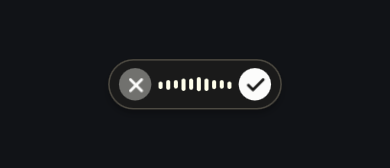

# Voxtype Flow Pill

A compact, Wispr Flow inspired dictation overlay for **Voxtype on Omarchy**.
The ten rounded cream bars follow live microphone levels inside a charcoal
capsule. Animated dots appear while transcribing, and the capsule fades away
when dictation finishes.



The **X** cancels dictation. The **checkmark** stops recording and transcribes.
The overlay leaves keyboard focus in the app where you are writing.

## Install

Requires a working **Voxtype 1.1.0+** installation, **Quickshell**, the
`voxtype-audio-bridge` binary, and **Python 3.11+**. Tested on Omarchy with
Voxtype 1.1.0 and Quickshell 0.3.1. Set up regular Voxtype dictation first.

```bash
git clone https://github.com/WW2-Master/voxtype-flow-pill.git
cd voxtype-flow-pill
./install.sh
```

Finish any active dictation before installing. The installer backs up existing
files, changes only overlay settings, and restarts Voxtype if it is running.
Your microphone, model, vocabulary, text output, and dictation shortcuts are
preserved. Use your existing dictation shortcut to activate it.

To install without restarting the service:

```bash
./install.sh --no-restart
```

## Customize

Edit `~/.config/voxtype/osd/flow-pill/FlowPill.qml`:

- `uiScale` changes the capsule size (default `1.2`).
- `audioLevel()` controls microphone sensitivity with smooth logarithmic
  compression. This preserves changes in loudness instead of clipping speech
  to a fixed bar height.

`osd.margin_px` controls the distance from the screen edge (default `48`).
Restart Voxtype while idle after changing the style:

```bash
systemctl --user restart voxtype
```

## Uninstall

```bash
./install.sh --uninstall
```

This restores the overlay settings and user frontend that existed before the
first installation, while preserving current non-overlay dictation settings.
Backups, including any edited overlay files, stay in
`~/.local/state/voxtype-flow-pill/backups/`.

The installer respects `XDG_CONFIG_HOME`, `XDG_DATA_HOME`, and `XDG_STATE_HOME`.

## How it works

The style uses Voxtype's audio bridge to read real microphone peak/RMS frames.
A short rolling window and fast attack/soft release keep the bars responsive.
The included user frontend adds pointer input over the capsule and a short
exit delay. Engine picker and meeting controls are retained.

This repository vendors Voxtype 1.1.0's Quickshell frontend, so future Voxtype
frontend changes require updating that copy. The installed files are under
`~/.config/voxtype/osd/flow-pill/` and `~/.local/share/voxtype/quickshell/`;
system package files are untouched.

To preview the appearance without recording microphone audio:

```bash
qs -p preview.qml
```

## Credits

Built on [Voxtype](https://github.com/peteonrails/voxtype) by Peter Jackson and
contributors, and [Quickshell](https://quickshell.org/). The visual design is
inspired by [Wispr Flow](https://wisprflow.ai/). This is an independent
community project.

MIT licensed. The included Voxtype frontend retains its upstream license.
